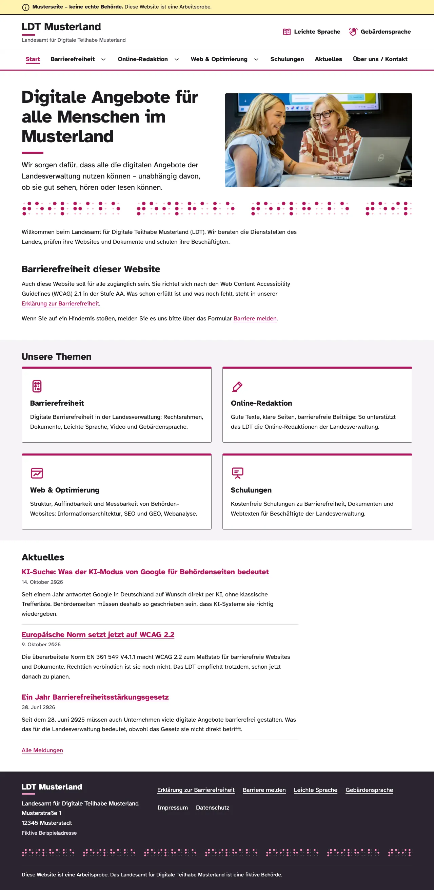
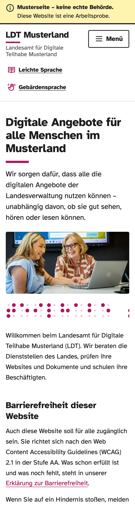
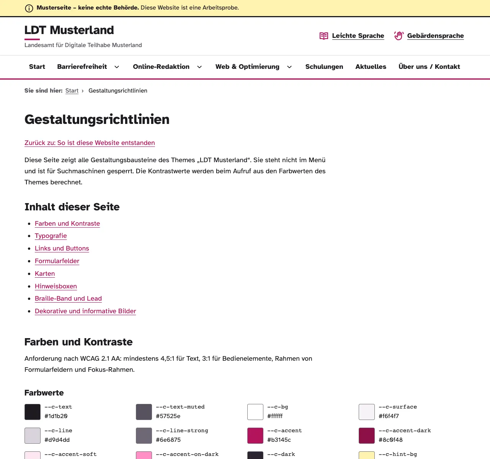
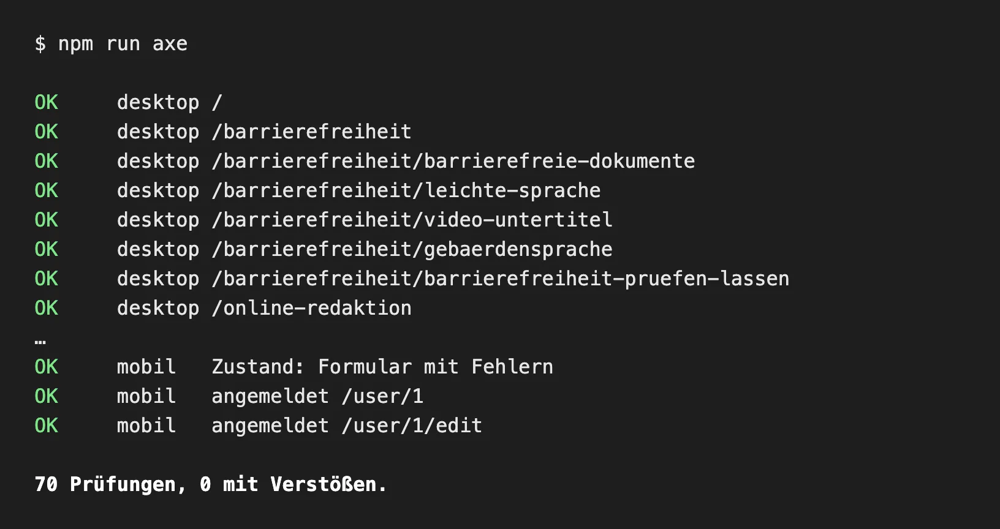

# LDT Musterland – barrierefreie Musterseite mit Drupal 11

> **Musterseite einer fiktiven Behörde (Landesamt für Digitale Teilhabe Musterland).
> Keine echte Behörde.**

## Ziel

Die Website zeigt am Beispiel einer erfundenen Landesbehörde, wie sich ein Webauftritt der
öffentlichen Verwaltung barrierefrei aufbauen, schreiben und prüfen lässt:
Ziel ist **WCAG 2.1 AA** (BITV 2.0), bei der Gestaltung zusätzlich WCAG 2.2 AA.
Dazu gehören klare Texte, Leichte Sprache, Gebärdensprache, ein Video mit Untertiteln und
Transkript, barrierefreie PDFs, ein Formular „Barriere melden“ und eine Erklärung zur
Barrierefreiheit. Ein Hinweis-Balken auf jeder Seite macht klar, dass es keine echte Behörde ist.

## Technik

- **Drupal 11** (Composer-Projekt `drupal/recommended-project`), PHP 8.3, Sprache Deutsch
- **Eigenes Theme** `ldt_musterland`: reines CSS mit Custom Properties, kein Build-Schritt,
  selbst gehostete Schrift Atkinson Hyperlegible, Fotos als WebP mit `srcset`
- **Eigene Module** `ldt_*` (siehe unten)
- **Automatisierte Tests** mit axe-core und Playwright
- Lokale Entwicklung mit **DDEV**, Konfiguration in `config/sync/`

## Ansicht









## Was man sich ansehen sollte

| Wo | Was |
|---|---|
| `web/themes/custom/ldt_musterland/` | Theme: Farb-Tokens mit Kontrastwerten (`css/base/tokens.css`), Navigation nach dem Disclosure-Muster (`js/navigation.js`), Templates, Bildvarianten (`src/BildVarianten.php`) |
| `web/modules/custom/ldt_video/` | HTML5-Video mit WebVTT-Untertiteln, Bildunterschrift als zugänglicher Name |
| `web/modules/custom/ldt_formulare/` | Fehlermeldungen in Formularen per `aria-describedby` mit dem Feld verknüpft |
| `web/modules/custom/ldt_musterhinweis/` | Musterseiten-Hinweis auf jeder Seite, Versionskennung für Datei-Adressen |
| `web/modules/custom/ldt_styleguide/` | Seite `/styleguide` mit allen Bausteinen und live berechneten Kontrasten |
| `tests/a11y/` | axe-core auf allen Seiten (Desktop und 375 px), Tastatur-Durchgang, Reflow bei 320 px, Meta-Daten, Quelltext |
| `scripts/pages.php` | Alle Seitentexte als Daten, angelegt mit `scripts/create-content.php` |

## Lokal starten und testen

Voraussetzungen: Docker Desktop, [DDEV](https://ddev.com), Node.js und Google Chrome für die Tests.

```bash
ddev start
ddev composer install
ddev drush site:install --existing-config -y   # Drupal aus config/sync/ aufsetzen
ddev drush uli                                 # Login-Link für das Backend
```

**Hinweis:** Seiteninhalte und hochgeladene Dateien (Fotos, PDFs, Video) liegen nicht im
Repository. `scripts/create-content.php` legt die Seiten an, erwartet die Dateien aber unter
`web/sites/default/files/` (siehe „Seiten und Texte“).

Tests (bei laufender DDEV-Umgebung):

```bash
cd tests/a11y
npm install
npm run alle    # axe, Tastatur, Reflow, Meta-Daten, Quelltext
```

## Lizenz

- **Eigener Code** (Theme, Module, Skripte, Tests, Konfiguration): GPL-2.0-or-later wie
  Drupal, siehe `LICENSE.txt`. Das gilt auch für Drupal-Kern und Contrib-Module.
- **Schrift** Atkinson Hyperlegible: SIL Open Font License 1.1
  (`web/themes/custom/ldt_musterland/fonts/OFL.txt`).
- **Fotos:** Unsplash-Lizenz. Sie liegen nicht im Repository, der Bildnachweis steht im Impressum.
- **Texte der Seiten** (`scripts/pages.php`, `scripts/meldungen.php`): © 2026 Rafael Fernandez.
  Es sind Mustertexte für eine fiktive Behörde. Sie gelten nicht als amtliche Auskunft und
  fallen nicht unter die GPL.

---

## Projektdetails

Lokal entwickelt mit DDEV, spätere Live-Adresse: **https://designpink.de/drupal**
(Strato Shared Hosting). Impressum und Datenschutz enthalten auf der Live-Seite die
Angaben des tatsächlichen Betreibers; im Repository stehen dort nur Platzhalter.

| | |
|---|---|
| Drupal | 11.x, Sprache Deutsch |
| PHP | 8.3 |
| Datenbank | MariaDB 11.8 (lokal) |
| Öffentlicher Ordner (Docroot) | `web/` |

## Ordnerstruktur

```
.ddev/          DDEV-Konfiguration (lokale Umgebung)
config/sync/    Exportierte Drupal-Konfiguration (drush cex / cim)
vendor/         PHP-Bibliotheken (von Composer, nicht im Git)
web/            Öffentlicher Ordner – nur dieser darf vom Webserver ausgeliefert werden
  modules/custom/   eigene Module
  themes/custom/    eigene Themes
  sites/default/    settings.php (+ settings.local.php auf dem Server)
composer.json   Liste der Abhängigkeiten (Drupal-Kern, Module, Drush)
```

## Was liegt wo?

| Was | Wo gespeichert | Wie kommt es auf Strato? |
|---|---|---|
| Einstellungen (Inhaltstypen, Felder, Menüs, Formulare, Module) | `config/sync/` (Git) | `drush cim` oder mit der Datenbank |
| Seiten, Menüpunkte, eigene Übersetzungen, Formular-Einsendungen | Datenbank | Datenbank-Export/-Import |
| Hochgeladene Dateien (Bilder, PDFs, Videos) | `web/sites/default/files/` | per SFTP hochladen |
| Eigener Code | `web/modules/custom/` (Git) | mit dem Projekt hochladen |

Nach Änderungen im Backend immer `ddev drush cex` ausführen und `config/sync` committen.

## Video mit Untertiteln

Auf jeder Basisseite gibt es die optionalen Felder **Video** (MP4/WebM) und
**Untertitel (WebVTT)**. Das Modul `web/modules/custom/ldt_video` gibt das Video als
`<video>` mit `<track kind="captions">` aus. Ist am Video eine Dateibeschreibung eingetragen,
steht es in `<figure>` mit `<figcaption>`; `<video aria-labelledby>` verweist darauf
(zugänglicher Name). Das Template `ldt-video.html.twig`
kann im späteren Theme überschrieben werden (gleichnamige Datei im Theme-Ordner `templates/`).

Zusätzlich gibt es das Feld **Text unter dem Video** (`field_text_unter_video`, Basic HTML):
Es steht direkt unter dem Player, etwa für den Hinweis auf die synthetische Stimme, das
Transkript als aufklappbaren Bereich (`<details>`/`<summary>`, im Textformat erlaubt) und
die Downloads. In `pages.php`: Schlüssel `video`, `untertitel` (Pfade relativ zu
`sites/default/files/`) und `unter_video`. Download-Links auf Dateien außerhalb von
`dokumente/` mit Unterordner: `{{file:untertitel/NAME.vtt|Linktext}}`.

**Erklärvideo „Was macht das LDT?“** – komplett lokal erzeugt, ohne Aufnahme:

```bash
node scripts/video/erstellen.mjs        # braucht say (macOS), ffmpeg, Chrome, tests/a11y/node_modules
ddev drush php:script scripts/create-content.php -- --overwrite --only=video
```

Das Skript spricht jeden Abschnitt mit `say` (Stimme Anna, Tempo 165), misst Dauer und
Sprechpausen (`ffmpeg silencedetect`), rendert die Folien (1920×1080) im Theme-Design,
setzt das MP4 (H.264/AAC) zusammen und schreibt Untertitel (WebVTT) und Transkript aus den
gemessenen Zeiten. Es bricht ab, wenn eine Untertitel-Einblendung kürzer als 1 s oder
länger als 6 s ist, mehr als zwei Zeilen hat oder ein Folieninhalt ins untere Drittel
reicht (dort liegen Untertitel und Steuerleiste). Texte, Untertitel-Aufteilung und
Bildbeschreibungen stehen oben im Skript. Ausgabe: Dateien unter `web/sites/default/files/`
(nicht im Git) und `scripts/video/transkript.html` (im Git, wird in `pages.php` eingebunden).

Damit Browser die Untertitel annehmen, muss `.vtt` als `text/vtt` ausgeliefert werden:
lokal über `.ddev/nginx/vtt.conf`, auf Strato über `AddType text/vtt .vtt` in `web/.htaccess`.

**Zusätzliche Dateitypen in `web/.htaccess`** (`.vtt`, `.dotx`, `.ott`) stehen in
`assets/htaccess-ergaenzungen.txt`. Composer hängt sie über `composer.json`
(`extra.drupal-scaffold.file-mapping`) bei jedem Core-Update automatisch wieder an –
`web/.htaccess` also nicht direkt bearbeiten, sonst geht die Änderung beim nächsten
Update verloren. Neu erzeugen: `ddev composer drupal:scaffold`.
Lokal (nginx) erledigen das `.ddev/nginx/vtt.conf` und `.ddev/nginx/vorlagen.conf`
(nach Änderungen `ddev restart`).

## Eigene Module (`web/modules/custom`)

| Modul | Aufgabe |
|---|---|
| `ldt_video` | Video mit WebVTT-Untertiteln als `<track>`, Bildunterschrift als zugänglicher Name (früher `designpink_video`) |
| `ldt_musterhinweis` | Hinweis-Balken „Musterseite“ (`role="note"`) ganz oben auf jeder Seite; Demo-Hinweis über Formularen, die nichts speichern/versenden; Versionskennung an Dateiadressen (siehe „Dateien ersetzen“) |
| `ldt_formulare` | Verknüpft Fehlermeldungen am Feld per `aria-describedby` mit dem Feld |

## Seiten und Texte

Die Platzhalter-Texte stehen in `scripts/pages.php`. Links zwischen Seiten werden mit
Linkit gespeichert (`data-entity-uuid`) und erst beim Ausgeben in die aktuelle URL
umgewandelt – sie funktionieren deshalb auch im Unterordner `/drupal`.
Im Editor: Link-Schaltfläche, dann Seitentitel eintippen und Vorschlag auswählen.

```bash
ddev drush php:script scripts/create-content.php                 # fehlende Seiten anlegen
ddev drush php:script scripts/create-content.php -- --overwrite  # ACHTUNG: überschreibt Texte
ddev drush php:script scripts/create-content.php -- --overwrite --only=video,schulungen  # nur diese Seiten
```

- `summary` in `pages.php` = Zusammenfassung (Kartentext); die Meta-Beschreibung ist
  `summary` + „– Musterseite einer fiktiven Behörde“.
- Hinweisbox im Text: `<div class="hinweis hinweis--info"><p><strong>Hinweis:</strong> …</p></div>`
  (im Editor über „Quelltext“; andere Klassen lässt das Textformat nicht zu).
- Vollständige englische Namen und Ausdrücke mit `<span lang="en">…</span>` auszeichnen
  (z. B. Web Content Accessibility Guidelines), eingedeutschte Fachbegriffe wie
  Screenreader oder Hashtag nicht. Das Textformat erlaubt dafür nur `<span lang>`.
- Vergleich Standardsprache / Leichte Sprache: `<div class="sprachvergleich"><div><h3>Standardsprache</h3>…</div>
  <div><h3>Leichte Sprache</h3><p>Satz<br>Satz</p>…</div></div>` – zweite Spalte = Leichte Sprache
  (1,25 rem, ohne Silbentrennung); jeder Satz eine Zeile (`<br>`), jeder Sinnabschnitt ein Absatz.
  Ab genug Platz nebeneinander, sonst untereinander (`css/components/ldt-sprachvergleich.css`).
  Das Textformat erlaubt dafür nur die Klasse `sprachvergleich`.
- Tabellen: Editor-Knopf „Tabelle“; Kopfzeile, Tabellenüberschrift (`<caption>`) und im
  Quelltext `<th scope="col">` bzw. `<th scope="row">`. Das Theme legt beim Ausgeben einen
  scrollbaren, per Tastatur erreichbaren Rahmen um jede Tabelle (`src/TabellenRahmen.php`,
  `css/components/ldt-tabellen.css`). Unter 40 rem wird jede Zeile zur Karte (Spaltenköpfe als
  sichtbare Beschriftung aus `data-label`, nur bei mehr als einer Datenzelle je Zeile;
  Tabellenrollen ausdrücklich per `role` gesetzt).
  Spalten nur mit Zahlen (deutsches Format, z. B. `4.820`, `2,4`, `26&nbsp;%`) werden automatisch
  rechtsbündig; reine Prozentspalten bekommen zusätzlich einen Balken (`aria-hidden`).
- Links auf Seiten ohne Inhaltstyp (z. B. `/styleguide`) dürfen als `<a href="/styleguide">` im Text
  stehen: Das Theme stellt beim Ausgeben den Basis-Pfad voran (`src/InterneLinks.php`), auf
  Strato also `/drupal/styleguide`. Links auf Inhalte immer per Linkit.
- Styleguide `/styleguide` heißt „Gestaltungsrichtlinien“ (noindex, nicht in der Sitemap) und
  verlinkt zurück auf „So ist diese Website entstanden“ (Schlüssel `entstehung`).
- Startseite: Die Seite „Start“ (/node/1, Alias /start) ist nur unter „/“ erreichbar; /start und
  /node/1 leiten dauerhaft (301) auf „/“ weiter (`ldt_musterhinweis`, `StartseiteWeiterleitung`,
  ohne Redirect-Modul). Links auf die Startseite im Text deshalb als `<a href="/">`.
- Datumsangaben im Text als `<time datetime="2026-11-12">12. November 2026</time>` (das Textformat
  erlaubt dafür genau `<time datetime>`).
- Impressum und Datenschutz enthalten Platzhalter für die echten Betreiberangaben.
- Fachseiten mit eindeutigem Titel: „Leichte Sprache in der Verwaltung“ und „Gebärdensprache auf
  Behörden-Websites“ (unter Barrierefreiheit) – im Menü kurz (`'menu_title'`), Pfade fest
  (`'pfad'`, sonst würde Pathauto sie aus dem neuen Titel neu bilden). Die Footer-Seiten heißen
  weiter „Leichte Sprache“ und „Gebärdensprache“.
- **Kopfbild und Leitsatz** (Felder `field_kopfbild`, `field_leitsatz` an der Basisseite;
  in `pages.php` Schlüssel `kopfbild` und `leitsatz`): Kopfbild im Breitformat oben auf den
  Übersichtsseiten, auf der Startseite im Einstieg neben dem Leitsatz (H1; der `<title>`
  bleibt „Start“, die Zusammenfassung ist der Einleitungssatz). Ausgabe als WebP in drei
  Größen mit `srcset`/`sizes` über die Bildstile `bild_640`, `bild_1280`, `bild_1920`
  (Theme: `BildVarianten`, Ausschnitt je Bild in `BildVarianten::AUSSCHNITT`). Kopfbilder
  laden sofort, Fotos im Fließtext lazy. Stimmungsbilder `alt=""`, Bilder mit Inhalt
  beschreibender Alternativtext (Regel in den Gestaltungsrichtlinien).
- Fotos ersetzen: Datei unter gleichem Namen hochladen, dann `drush image:flush --all` und
  `drush cr` – sonst liefert der Server die alten WebP-Varianten aus. Die Versionskennung
  (`?v=…`) der Varianten richtet sich nach der Originaldatei.
- Sitemap: Seiten und Meldungen automatisch, dazu die Startseite und `/aktuelles` als eigene Links
  (simple_sitemap, „Benutzerdefinierte Links“).

### Dokumente und Grafiken (`web/sites/default/files/dokumente/`)

Die Beispieldateien sind **nicht im Git-Repository** (Ordner `files/` wird ignoriert).
Original-Ablage: `~/Documents/Claude/Drupal-Dokumente/` (ohne Unterordner `quellen/`).

| Datei | Seite |
|---|---|
| `Merkblatt-vorher.pdf` (absichtlich nicht barrierefrei), `Merkblatt-nachher.pdf`, `Struktur-vorher.png`, `Struktur-nachher.png` | Barrierefreie Dokumente |
| `Checkliste-Redaktion.pdf`, `LDT-Vorlage.dotx`, `LDT-Vorlage.ott` | Arbeitshilfe Redaktion |
| `sharepic-wcag22.png` (Instagram-Infografik) | Social Media |
| `Schulung-Grundlagen-Folien.pdf`, `Uebungsblatt-Tastaturpruefung.pdf` | Schulungen |
| `Leistungsbeschreibung-DGS-Videos.pdf` | Gebärdensprache (Fachseite unter Barrierefreiheit) |

**Fotos (`web/sites/default/files/bilder/`, ebenfalls nicht im Git):** `start.jpg`,
`barrierefreiheit.jpg`, `online-redaktion.jpg`, `web-optimierung.jpg`, `card-sorting.jpg`,
`schulungen.jpg` (Unsplash, je 2400 px breit; Original-Ablage
`~/Documents/Claude/Drupal-Dokumente/bilder/` mit `bildnachweis.txt`). Bildnachweis im
Impressum. Die WebP-Varianten (`files/styles/bild_640|1280|1920/`) erzeugt Drupal selbst –
nicht hochladen.
| `Transkript-Was-macht-das-LDT.txt` sowie `../videos/was-macht-das-ldt.mp4` und `../untertitel/was-macht-das-ldt.vtt` (erzeugt von `scripts/video/erstellen.mjs`) | Video & Untertitel |

In `pages.php` eingebunden mit `{{file:NAME|Linktext}}` (Format und Größe werden
automatisch angehängt, z. B. „(PDF, 61 KB)“) und `{{img:NAME|Alternativtext}}`
(optional mit Anzeigebreite: `{{img:NAME|Alternativtext|432}}`). Links auf Meldungen:
`{{link:meldung/SCHLÜSSEL|Text}}` (Meldungen vorher mit `create-meldungen.php` anlegen).
Beide werden pfadunabhängig über die Datei-UUID gespeichert. Wird eine Datei ersetzt,
die Seite mit `--overwrite --only=…` neu schreiben, damit die Größe stimmt.

**Dateien ersetzen und Browser-Zwischenspeicher.** Der Server erlaubt Browsern, Dateien
sehr lange zwischenzuspeichern (bis zu 10 Jahre). Damit eine unter gleichem Namen ersetzte
Datei trotzdem sofort ankommt, hängt Drupal an jede Adresse einer öffentlichen Datei eine
Versionskennung aus Änderungszeit und Größe an, z. B. `was-macht-das-ldt.mp4?v=14e1d7be`
(`ldt_musterhinweis`, Dienst `VersionierteDateiUrls`, ersetzt den `file_url_generator`).
Das gilt automatisch für Video, Untertitel, Transkript, PDFs, Bilder und Backend-Uploads;
Dateinamen bleiben gleich, alte Dateien entstehen nicht. Ändert sich die Datei, ändert sich
die Kennung. Wichtig: Nach dem Ersetzen per SFTP (ohne Backend) `drush cr` ausführen,
sonst liefern zwischengespeicherte Seiten noch die alte Kennung aus.

PDF-Prüfung (Stand Oktober 2026, veraPDF 1.30.3): `verapdf --flavour ua1 DATEI.pdf`
→ Merkblatt-vorher FAIL (gewollt), Merkblatt-nachher PASS, Checkliste PASS,
Schulungsfolien PASS, Übungsblatt PASS, Leistungsbeschreibung DGS-Videos PASS
(beide barrierefreien PDFs mit 1× H1 und darunter H2).

## Aktuelles (Inhaltstyp „Meldung“)

- Felder: Titel, **Datum** (`field_datum`, Veröffentlichung, bestimmt die Reihenfolge),
  **Text** mit **Teaser** (= Zusammenfassung und Meta-Beschreibung), **Quellen**
  (`field_quellen`, externe Links, mehrfach), Metatags.
- Übersicht `/aktuelles` (View `aktuelles`, neueste zuerst, Überschriften h2) und
  Startseiten-Block „Aktuelles“ (3 neueste, h3, Link „Alle Meldungen“).
- Adressen: `/aktuelles/[titel]` (Pathauto-Muster „Meldung“; Punkte werden zu „-“,
  z. B. `wcag-2-2`).
- Datum als `<time datetime="2026-10-09">9. Oktober 2026</time>` (Datumsformat `ldt_datum`).
- Templates: `node--meldung.html.twig` (Datum, Text, „Quelle:“-Liste),
  `node--meldung--teaser.html.twig`, `node--meldung--kompakt.html.twig`;
  Datum und Quellen bereitet `LdtMusterlandHooks::preprocessNode()` auf.
- Strukturierte Daten: `NewsArticle` (Modul `schema_article`) mit headline,
  datePublished, publisher/author = GovernmentOrganization LDT.
- Texte in `scripts/meldungen.php`, anlegen mit
  `ddev drush php:script scripts/create-meldungen.php` (`-- --overwrite` überschreibt).
  Fremdsprachige Quellen (`'en'`) bekommen `lang`/`hreflang` und den Zusatz „(englisch)“ –
  im Backend-Formular lässt sich die Sprache einer Quelle nicht setzen.
- Marken (`{{link:…}}` usw.) für beide Skripte stehen in `scripts/marken.php`.

## Formular „Barriere melden“ (Vorqualifizierung)

- Felder: **Was ist das Problem?** (Pflicht, Radio-Gruppe; Werte `inhalt`, `bedienung`,
  `dokument_video`, `darstellung`, `technik`, `sonstiges`), Seite, Beschreibung,
  **Hilfsmittel** (freiwillig, Checkboxen), **Gerät und Browser** (freiwillig), E-Mail.
- Unsichtbares berechnetes Feld **Kategorie** (Kurzname, z. B. „Bedienung“): Betreff der
  Benachrichtigung „Barriere melden – Bedienung“ und Spalte in der Übersicht der Einsendungen.
- „So geht es weiter“ steht als Element nach dem Absende-Knopf (Link zur Erklärung per Linkit).
- „Betroffene Seite“ ist ein Textfeld (`inputmode="url"`, keine Formatprüfung): Adresse, Pfad
  oder Seitenname. Der Link „Barriere melden“ im Seitenfuß übergibt die aktuelle Seite als
  `?seite=…` (Theme, `preprocessMenu()`); `ldt_formulare` füllt das Feld damit vor
  (ohne HTML und Steuerzeichen, höchstens 255 Zeichen).
- Nach dem Absenden mit Fehlern bekommt die Fehlerliste den Fokus (`tabindex="-1"` in
  `status-messages.html.twig`, `js/fehlerliste.js`).
- Modul `ldt_formulare`: Fehlermeldungen von Feldgruppen per `aria-describedby` am `<fieldset>`;
  `js/fehlerliste.js` setzt beim Klick in der Fehlerliste den Fokus in die Radio-Gruppe.
- Datenschutz: Die Hilfsmittel-Angabe kann Rückschlüsse auf eine Behinderung zulassen
  (Gesundheitsdaten, Art. 9 DSGVO). Deshalb freiwillig und mit Zweck; bei einem echten Betrieb
  mit der Datenschutzerklärung abstimmen. Live speichert das Formular ohnehin nichts (Demo-Modus).

## Metadaten und strukturierte Daten

- **Meta-Beschreibung:** im Seiten-Formular rechts unter *Metadaten → Beschreibung*
  (max. 160 Zeichen). Leer = automatische Kurzfassung des Seitentextes.
- **schema.org (JSON-LD)** im `<head>` jeder Seite:
  - `GovernmentOrganization` (LDT Musterland, als fiktiv beschrieben) – globale Metatag-Standards
  - `WebPage` mit Beschreibung, Sprache und Herausgeber (`@id` → Organisation) – Standards „Inhalt“ und „Startseite“
  - `BreadcrumbList` aus der Pfadnavigation (ohne die aktuelle Seite)
- Prüfen: Seitenquelltext nach `application/ld+json` durchsuchen, oder live mit dem
  Schema Markup Validator (validator.schema.org).

## Theme „LDT Musterland“ (`web/themes/custom/ldt_musterland`)

Eigenes Theme (Starterkit), reines CSS mit Custom Properties, kein Build-Schritt.
Olivero ist installiert, aber nicht aktiv.

- **Farben/Tokens:** `css/base/tokens.css` – Kontrastwerte stehen dahinter.
  Die Seite **/styleguide** (nicht verlinkt, noindex) berechnet alle Kontraste live
  aus dieser Datei und zeigt alle Bausteine.
- **Schrift:** Atkinson Hyperlegible, selbst gehostet (`fonts/`, Lizenz `fonts/OFL.txt`).
- **Navigation:** Disclosure-Muster (`js/navigation.js`): Oberpunkte sind Links,
  Untermenüs öffnen über eigene Buttons mit `aria-expanded`; Escape schließt.
  Mobil (< 64 em) Menü-Button. Ohne JavaScript bleibt alles als Liste nutzbar.
- **Servicelinks** (Leichte Sprache, Gebärdensprache): Menü „Servicelinks“; das Icon
  kommt aus der Link-Option `ldt_icon` (eigene Icons in `templates/icons/`).
- **Startseiten-Karten:** View „Startseite: Themen“ zeigt Basisseiten mit
  *Auf der Startseite* (promote); Kartentext = Zusammenfassung des Textfelds.
- **Druck:** `css/print.css`.

## Barrierefreiheits-Prüfung (`tests/a11y`)

Voraussetzung: Node.js, Google Chrome, laufende DDEV-Umgebung.

```bash
cd tests/a11y
npm install          # einmalig
npm run axe          # axe-core: alle Seiten, Desktop + 375 px, Menü offen, Formularfehler
npm run tastatur     # Skip-Link, Tab-Reihenfolge, Fokus sichtbar, Menüs, Formular
npm run reflow       # 320 px Breite (= 400 % Zoom) ohne waagerechtes Scrollen
npm run meta         # Meta-Beschreibung: höchstens 160 Zeichen, endet auf den Musterseiten-Zusatz; keine doppelten <title>
npm run quelltext    # kein „designpink“ in HTML/CSS/JS (außer Hostname; ohne Impressum/Datenschutz)
npm run englisch     # Suche nach englischen Resten
npm run screenshots  # Screenshots nach tests/a11y/ergebnisse/
```

**Erklärung zur Barrierefreiheit aktuell halten:** Kommt eine neue Prüfart hinzu (z. B. ein
weiterer Screenreader, Sprachsteuerung, Windows-Kontrastmodus) oder ändert sich ein Ergebnis,
den Abschnitt „Erstellung dieser Erklärung“ in `scripts/pages.php` (Schlüssel `erklaerung`)
anpassen, das Datum „zuletzt überprüft“ setzen und die Seite neu schreiben
(`create-content.php -- --overwrite --only=erklaerung`). Seitenzahlen nicht fest nennen.

## Lokale Umgebung

Voraussetzung: Docker Desktop läuft.

```bash
ddev start        # Umgebung starten
ddev stop         # Umgebung stoppen (Daten bleiben erhalten)
ddev restart      # neu starten, z. B. nach Änderungen in .ddev/
ddev describe     # Übersicht: URLs, Ports, Datenbank-Zugang
```

### Seite öffnen

```bash
ddev launch                 # öffnet die Startseite im Browser
ddev drush uli              # erzeugt einen Einmal-Login-Link für "admin"
```

Lokale URL: **https://designpink.ddev.site:33001**
(Port 33001, weil Port 443 auf diesem Mac schon belegt ist. Die aktuelle URL zeigt immer `ddev describe`.)

Admin-Login: `/user/login`, Benutzer `admin`. Das Passwort steht in keiner Datei –
bei Verlust: `ddev drush user:password admin "NEUES-PASSWORT"`.

> Hinweis: Die FRITZ!Box blockiert per DNS-Rebind-Schutz Adressen, die auf 127.0.0.1 zeigen.
> Deshalb steht `designpink.ddev.site` in `/etc/hosts`.

### Häufige Drush-Befehle

```bash
ddev drush cr               # Cache leeren (hilft bei fast allem)
ddev drush status           # Zustand der Installation
ddev drush cex              # Konfiguration nach config/sync exportieren (dann committen)
ddev drush cim              # Konfiguration aus config/sync importieren
ddev composer require drupal/MODULNAME   # Modul hinzufügen
ddev drush en MODULNAME     # Modul aktivieren
```

### Datenbank exportieren / importieren

```bash
mkdir -p backups
ddev export-db --file=backups/designpink-$(date +%Y-%m-%d).sql.gz   # Export (gzip)
ddev import-db --file=backups/DATEINAME.sql.gz                      # Import
ddev snapshot               # schneller Sicherungspunkt (nur lokal)
ddev snapshot restore --latest
```

`backups/` und `*.sql*` sind in `.gitignore` – Datenbank-Dumps kommen nie ins Repository.

## Später: Deployment zu Strato

Checkliste für den ersten Upload auf den Strato-Webspace:

1. **`web` als öffentliches Verzeichnis.**
   Nur der Inhalt von `web/` darf über die URL erreichbar sein; `vendor/`, `config/`,
   `composer.json` usw. gehören außerhalb des öffentlich erreichbaren Bereichs.
   Empfohlene Struktur auf dem Webspace:
   ```
   /drupal-projekt/            ← komplettes Projekt (vendor, config, web, …)
   /<Domain-Ordner>/drupal  →  Verweis (Symlink) auf /drupal-projekt/web
   ```
   Der Symlink lässt sich per SSH anlegen (`ln -s`). Prüfen, ob das Strato-Paket SSH
   enthält. Ohne SSH: mit dem Strato-Support klären, wie `web/` als Ordner
   `/drupal` eingebunden werden kann.

2. **Unterordner `/drupal`.**
   In `web/.htaccess` die Zeile `# RewriteBase /drupal` aktivieren (das `#` entfernen),
   falls saubere URLs (`/drupal/user/login`) nicht funktionieren.
   Achtung: `composer update` des Drupal-Kerns kann `web/.htaccess` überschreiben –
   danach mit `git diff web/.htaccess` prüfen und die Änderung wiederherstellen.
   Drupal erkennt den Unterordner ansonsten selbst; im Code nie absolute Pfade wie
   `/sites/...` fest eintragen, sondern Drupals URL-Funktionen verwenden.

3. **PHP-Abhängigkeiten.**
   Auf Strato `composer install --no-dev` ausführen (per SSH) oder lokal ausführen
   und den Ordner `vendor/` mit hochladen. PHP-Version im Strato-Kundenbereich auf 8.3 stellen.

4. **Datenbank-Import.**
   Im Strato-Kundenbereich eine MySQL/MariaDB-Datenbank anlegen.
   Lokal exportieren (`ddev export-db --file=backups/live.sql.gz`) und über
   phpMyAdmin bei Strato (oder per SSH mit `mysql`) importieren.
   Dateien aus `web/sites/default/files/` (Ordner `dokumente/`, `videos/`, `untertitel/` und weitere Uploads) separat per SFTP hochladen.
   **Wichtig:** dazu gehört der Ordner `web/sites/default/files/dokumente/` mit den
   Beispiel-PDFs, Grafiken und Vorlagen – er ist nicht im Git-Repository. Die Einträge
   dazu stehen in der Datenbank; ohne die Dateien führen die Downloads ins Leere.
   **Dateirechte:** alle Dateien in `files/` auf `644` setzen (Ordner `755`), damit der
   Webserver sie lesen kann. Aus macOS kopierte Dateien haben teils `600` (nur für den
   Eigentümer lesbar) – dann liefert der Server einen Fehler statt der Datei. Prüfen und
   setzen per SSH: `find files -type f ! -perm 644` bzw.
   `find files -type f -exec chmod 644 {} +` und `find files -type d -exec chmod 755 {} +`;
   ohne SSH im SFTP-Programm (Dateiattribute/Rechte). Lokal vorher prüfen:
   `find web/sites/default/files/{dokumente,videos,untertitel,bilder} -type f ! -perm 644`.
   Hochladen auch: `bilder/` (Fotos). Nicht hochladen: `css/`, `js/`, `php/`, `styles/` – die
   erzeugt Drupal auf dem Server neu.

5. **settings.php / settings.local.php.**
   `settings.php` ist im Repository und enthält keine Zugangsdaten. Sie bindet automatisch
   `settings.local.php` ein, falls vorhanden. Auf dem Server:
   `web/sites/default/example.settings.local.php` nach `settings.local.php` kopieren
   und Datenbank-Zugangsdaten sowie einen neuen `hash_salt` eintragen.
   Strato-Zugangsdaten niemals ins Git-Repository!
   Danach `settings.php` und `settings.local.php` schreibschützen (Rechte 444).

6. **trusted_host_patterns.**
   Schon in der Vorlage enthalten: nur `designpink.de` und `www.designpink.de` erlauben.
   Fehlt die Einstellung, zeigt der Statusbericht eine Warnung; ist sie falsch,
   erscheint „The provided host name is not valid for this server“.

7. **Nach dem Upload.**
   `drush cr` (per SSH) bzw. `/drupal/update.php` aufrufen, dann den Statusbericht unter
   *Berichte → Statusbericht* prüfen (Dateirechte für `sites/default/files`, Cron usw.).

8. **Musterseiten-Schutz prüfen (vor dem Hochladen!).**
   In `example.settings.local.php` steht der Block „MUSTERSEITEN-SCHUTZ (live)“. Er wird mit
   in die `settings.local.php` auf dem Server übernommen und schaltet live ein:
   - `noindex, nofollow` auf allen Seiten (Metatag),
   - Demo-Modus für „Barriere melden“: nichts speichern, nichts versenden, nur Bestätigung;
     über dem Formular erscheint automatisch ein Demo-Hinweis.

   Nach dem Upload prüfen:
   - Seitenquelltext enthält `<meta name="robots" content="noindex, nofollow" />`
   - `/drupal/barriere-melden` zeigt den gelben Demo-Hinweis über dem Formular
   - per SSH: `drush cget metatag.metatag_defaults.global tags --include-overridden`

## Passwortschutz (optional)

Solange die Seite nicht öffentlich sein soll, kann sie per HTTP-Basic-Auth geschützt
werden. Vorlage (auskommentiert) – an den **Anfang** von `web/.htaccess` auf dem Server:

```apache
# --- Passwortschutz Musterseite ---------------------------------------------
# AuthType Basic
# AuthName "Musterseite - Zugang nur mit Passwort"
# AuthUserFile /ABSOLUTER/PFAD/AUF/DEM/SERVER/drupal-projekt/.htpasswd
# Require valid-user
# ----------------------------------------------------------------------------
```

- `AuthUserFile` braucht den **absoluten Serverpfad**. Er lässt sich bei Strato im
  Kundenbereich bzw. per SSH mit `pwd` im Projektordner ermitteln. Diesen Pfad nur auf dem
  Server eintragen, nicht ins Repository.
- `.htpasswd` **außerhalb von `web/`** ablegen (z. B. im Projektordner), nie ins Repository.
- Datei erzeugen (fragt das Passwort ab, es landet nicht im Shell-Verlauf):
  `htpasswd -c -B /PFAD/.htpasswd BENUTZERNAME`
  (ohne SSH: lokal mit `htpasswd -n -B BENUTZERNAME` erzeugen und die Ausgabezeile per SFTP
  in die Datei `.htpasswd` schreiben).
- Nur über HTTPS nutzen – Basic-Auth überträgt das Passwort sonst lesbar.
- Achtung: `composer update` kann `web/.htaccess` überschreiben (siehe Punkt 2).
